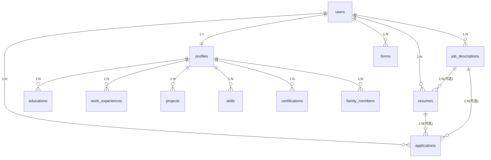

# 01 · 智能简历投递系统 — 架构设计方案

> 角色：资深全栈架构师 · 版本 v1.0 · 2026-07-16
> 本文档为指令 1 的交付物，是后续所有开发指令（2~10）的依据。

---

## 1. 系统概述

系统辅助用户完成两类求职投递场景：

| 场景 | 输入 | 系统动作 | 输出 |
| --- | --- | --- | --- |
| 招聘公告场景（事业单位/国企） | 报名表文件（PDF/Word/Excel） | 识别表单字段 → 与用户档案做字段映射 → 自动填充 | 已填写的报名表文件（下载） |
| 招聘网站场景（社招/校招） | 岗位 JD 文本 | 解析 JD 要求 → 匹配用户档案 → 定制生成简历 | 定制化简历（HTML/PDF） |

支撑能力：用户档案中心、AI 诊断、面试 Q&A 生成、投递记录追踪。

## 2. 总体架构

```
┌────────────────────────────────────────────────────────────────┐
│  客户端层（后续实现）   React 18 + TailwindCSS / Hermes Skill    │
└──────────────────────────────▲─────────────────────────────────┘
                               │ HTTPS / JSON（统一响应包 {code,message,data}）
┌──────────────────────────────┴─────────────────────────────────┐
│  接入层  FastAPI (main.py)                                      │
│   CORS 中间件 · 全局异常处理 · JWT 认证依赖 · 请求校验            │
├─────────────────────────────────────────────────────────────────┤
│  路由层 routers/      auth · profile · jd · resume · form · application │
├─────────────────────────────────────────────────────────────────┤
│  业务层 services/                                               │
│   profile_service   jd_service      resume_service              │
│   form_service      application_service                         │
│   ai_service(Kimi API 封装)  resume_renderer(HTML→PDF)          │
│   form_parser(报名表解析)      form_filler(报名表填充)            │
├─────────────────────────────────────────────────────────────────┤
│  数据访问层 repositories/  base(泛型 CRUD) + 各实体 Repo         │
├─────────────────────────────────────────────────────────────────┤
│  模型层 models/  SQLAlchemy 2.0 ORM（12 张表）                   │
├──────────────────┬──────────────────────┬───────────────────────┤
│ MySQL 8.0        │ Redis 7              │ 本地文件系统           │
│ 结构化数据+JSON   │ 缓存/限流/任务队列    │ uploads/ exports/     │
└──────────────────┴──────────────────────┴───────────────────────┘
                               │
                    外部依赖：Kimi API（https://api.moonshot.cn/v1）
```

**模块关系**： routers 只做参数校验与调度；所有 AI 调用收敛在 `ai_service`；文件解析/填充收敛在 `form_parser` / `form_filler`；渲染收敛在 `resume_renderer`；数据库访问只经过 repositories。

## 3. 核心数据流

### 3.1 JD 定制简历流（招聘网站场景）
```
用户粘贴 JD ──▶ POST /jd/parse ──▶ jd_service ──▶ ai_service.parse_jd
      │                                        (Kimi 结构化解析)
      ▼                                                │
job_descriptions 表(raw_text + parsed_data) ◀──────────┘
      │
      ▼ POST /resumes/generate (jd_id + preferences)
resume_service ──▶ 读取 profiles 全量档案 ──▶ ai_service.generate_resume
      │                                        (匹配度/强弱点/定制简历 JSON)
      ▼
resumes 表(resume_data, match_score, highlights, gaps)
      │
      ▼ POST /resumes/{id}/export
resume_renderer ──▶ Jinja2 渲染 HTML ──▶ Playwright 导出 PDF ──▶ 文件下载
```

### 3.2 报名表填充流（招聘公告场景）
```
上传报名表 ──▶ POST /forms/upload ──▶ forms 表(uploaded)
      ▼ GET /forms/{id}/analysis
form_service ──▶ form_parser（pdfplumber/python-docx/openpyxl，扫描件走 OCR）
      ▼ 保存 form_structure ──▶ forms 表(analyzed)
      ▼ POST /forms/{id}/mapping
ai_service.map_form_fields（表单字段 × 用户档案 → 映射+置信度+填充值）
      ▼ 保存 field_mapping ──▶ forms 表(mapped)
      ▼ POST /forms/{id}/fill
form_filler 按映射写入文件 ──▶ forms 表(filled) ──▶ GET /forms/{id}/download 下载
```

### 3.3 投递追踪流
简历导出或报名表填充完成后创建 applications 记录 → 状态机
`applied → viewed → interview → offer / rejected`，统计接口输出转化率与待跟进列表。

## 4. 模块设计（六大模块职责）

1. **用户档案中心 Profile**：结构化存储教育/工作/项目/技能/证书/家庭成员；每条经历带 `visibility`（是否进简历）与 `priority`（排序权重）；维护 `completeness_score` 完整性评分。
2. **JD 解析引擎 JD Parser**：`ai_service.parse_jd` 输出硬性/软性要求、核心职责、加分项、中英文 ATS 关键词、学历/年限/薪资。
3. **简历生成引擎 Resume Generator**：`ai_service.generate_resume` 融合「档案 × JD 解析 × 用户偏好」，产出结构化简历 JSON + 匹配度评分 + 强弱点 + 建议。
4. **报名表处理器 Form Filler**：三格式解析 → 统一 `FormStructure` 模型 → AI 字段映射 → 按格式回填。
5. **简历渲染器 Resume Renderer**：Jinja2 模板（technical/management）→ HTML → Playwright(主)/WeasyPrint(备) 导出 A4 PDF。
6. **投递管理 Application Tracker**：投递 CRUD、状态机、统计（按状态/渠道/转化率/近 7 天）、跟进提醒。

## 5. 数据库 ER 设计



设计要点：
- 全部使用 `UUID` 主键（MySQL 以 CHAR(32) 存储 hex，应用侧 `uuid4` 生成，跨库可移植）。
- 弹性数据用 `JSON`（MySQL 8 原生 JSON 类型）：`description`(bullet 数组)、`tech_stack`、`parsed_data`、`resume_data`、`form_structure`、`field_mapping`、`filled_data` 等——兼顾结构化查询（Multi-Valued Index 可扩展）与 AI 输出的灵活 schema。
- 经历类表统一带 `order_index / visibility / priority`，渲染简历时按 `priority DESC, order_index ASC` 过滤排序，实现「一份档案、多份定制简历」。
- 状态字段用 CHECK 约束模拟枚举，避免过早引入 PostgreSQL ENUM 的迁移成本。
- 完整 DDL 见 `sql/init.sql`（含索引、外键、注释、`ON UPDATE CURRENT_TIMESTAMP` 自动维护 updated_at）。

## 6. API 分层设计

```
Router（路由层）      参数解析 · JWT 鉴权 · 调用 Service · 包装统一响应
   │  禁止直接写 SQL / 调 AI
Service（业务层）     事务编排 · 业务规则 · 调 AI/渲染/文件组件 · 组合多个 Repo
   │  禁止出现 HTTP 概念（Request/Response）
Repository（数据层）  单实体 CRUD 与查询（继承泛型 BaseRepository）
   │
Model（模型层）       SQLAlchemy ORM 映射 + 关系 + 约束
```

横切约定：
- 统一响应体：`{"code": 0, "message": "success", "data": {...}}`；业务错误用自定义 `AppException`（code + http_status），由全局异常处理器统一转换。
- 认证：OAuth2 Bearer JWT，`get_current_user` 依赖注入到所有受保护路由。
- 事务：Service 方法内 `await db.commit()`；多步写入失败回滚。
- 分页/筛选：列表接口统一 `page/size` + 领域筛选参数。

## 7. 项目目录结构

见指令 3 的目录树（`app/` 下 models / schemas / routers / services / repositories / utils / templates，外加 alembic、tests、docs、sql、docker 配置）。实现时严格按该结构落盘。

## 8. 关键技术选型理由

| 选型 | 理由 |
| --- | --- |
| FastAPI | 原生 async、Pydantic 校验、自动生成 OpenAPI（指令 10 直接复用给 Hermes Skill） |
| SQLAlchemy 2.0 + asyncpg | 全异步链路，避免请求线程阻塞；2.0 风格类型标注清晰 |
| MySQL 8 + JSON | 经历/AI 结果 schema 多变，原生 JSON 类型免频繁迁移；utf8mb4 全中文友好；运维普及度高 |
| Redis | 缓存 AI 解析结果、登录限流、后续异步任务队列（ARQ/Celery 可平滑接入） |
| Kimi API（OpenAI 兼容 SDK） | 长文本处理强（JD/简历/报名表）；`response_format=json_object` 保证结构化输出 |
| tenacity | AI 调用的指数退避重试（最多 3 次），屏蔽网络抖动 |
| Jinja2 + Playwright | HTML/CSS 模板所见即所得，Chromium 打印 PDF 还原度最高；WeasyPrint 兜底 |
| pdfplumber / python-docx / openpyxl / pypdf | 覆盖报名表三大格式的解析与回填；OCR（paddleocr）做懒加载可选依赖 |
| python-jose + passlib | JWT 签发/校验 + bcrypt 密码哈希，无状态认证 |
| Alembic | 版本化迁移，容器启动时 `alembic upgrade head` 自动建表 |
| Docker Compose | app/db/redis 一键编排，本地文件系统后续可切 S3（file_handler 已抽象） |

## 9. 安全与扩展考虑

- 密码 bcrypt 哈希；JWT 有过期时间；密钥全部走环境变量（.env）。
- 文件上传限制大小/扩展名，落盘文件名 UUID 化防路径穿越。
- AI 调用设超时与重试；token 用量记录日志，便于成本核算。
- 后续扩展：Celery/ARQ 异步化简历生成与 PDF 导出；MinIO/S3 替换本地存储；前端 React 接入同一套 OpenAPI。
